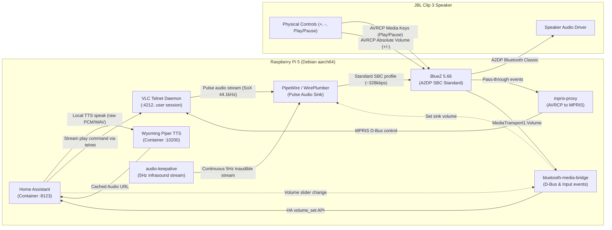

# HomePi Homeserver & Docker Stacks — Server Guide

A fully modular, production-ready Docker Compose environment and host automation suite running on a Raspberry Pi (`aarch64`, Debian/Linux).

This repository contains the Compose orchestration, stack configurations, host systemd helper services, and maintenance scripts for the **HomePi** server.

---

## 1. System Overview & Architecture

- **Host Hardware:** Raspberry Pi (`aarch64`)
- **Host IP:** `192.168.1.150`
- **Default User:** `jake` (`PUID=1000`, `PGID=1000`)
- **Timezone:** `Asia/Kolkata`
- **Root Project Directory:** `/home/jake/HomeServer`
- **Storage Strategy:**
  - **Fast System Storage (MicroSD / SSD):** OS, Docker binaries, Compose projects, application config bind-mounts (`data/`).
  - **High-Capacity Media & NAS Storage (External USB 3.0 HDD):** Formatted as `ext4`, permanently mounted at `/mnt/hdd` (Samba shares: `[HomePiStorage]`, `[JellyfinMedia]`).
- **Orchestration:** Docker Compose v2 utilizing the root [`compose.yml`](compose.yml) `include:` directive to consolidate 4 isolated stack definitions.

---

## 2. Directory Structure

```text
/home/jake/HomeServer/
├── compose.yml                              # Root Compose project (`homeserver`) including all stacks
├── .dockerignore                            # Build & Docker context exclusion rules
├── .env                                     # Environment variables & secrets (gitignored)
├── .env.example                             # Template environment file
├── .gitignore                               # Git exclusions (secrets, persistent data, logs)
├── memory.md                                # Persistent architectural reference & migration history
├── README.md                                # This server guide
├── config/                                  # Audio subsystem tuning configurations
│   ├── pipewire/
│   │   └── 10-rates.conf                    # PipeWire 44.1/48kHz clock rates & 2048 quantum headroom
│   └── wireplumber/
│       └── 51-bluez-custom.lua              # WirePlumber SBC profile & zero-suspend rules
├── scripts/                                 # Host automation scripts & systemd units
│   ├── update.sh                            # Validates, pulls, rebuilds, updates & prunes containers
│   ├── updater-server.py                    # Lightweight HTTP API (:9911) for Glance 1-click updates
│   ├── homeserver-updater.service           # systemd unit for updater-server.py
│   ├── media-sorter.py                      # Inotify-based Jellyfin media sorter & subtitle downloader
│   ├── homeserver-media-sorter.service      # systemd unit for media-sorter.py
│   ├── bluetooth-reconnect.py               # Auto-reconnect daemon for Bluetooth speaker & sink setup
│   ├── homeserver-bluetooth-reconnect.service # systemd unit for bluetooth-reconnect.py
│   ├── homeserver-vlc.service               # Headless cvlc telnet daemon (:4212) with pre-buffering
│   ├── homeserver-mpris-proxy.service       # BlueZ MPRIS proxy bridging speaker buttons to VLC
│   ├── bluetooth-media-bridge.py            # Hardware AVRCP buttons & bidirectional volume sync
│   ├── homeserver-bluetooth-media-bridge.service # systemd unit for bluetooth-media-bridge.py
│   ├── audio-keepalive.py                   # Streams inaudible 5Hz signal preventing JBL 15-min auto-off
│   └── homeserver-audio-keepalive.service   # systemd unit for audio-keepalive.py
├── stacks/                                  # Modular Compose stack definitions
│   ├── core/
│   │   └── compose.yml                      # pihole, npm (Nginx Proxy Manager), portainer, watchtower
│   ├── media/
│   │   └── compose.yml                      # jellyfin (hardware accelerated, host networking)
│   ├── monitoring/
│   │   └── compose.yml                      # glance (dashboard), glances (system telemetry)
│   └── iot/
│       ├── compose.yml                      # mosquitto (MQTT), flask_app, homeassistant, wyoming-piper
│       └── flask_app/                       # Custom Flask IoT sensor dashboard + Dockerfile
├── data/                                    # Persistent bind-mounted configs & state (gitignored)
│   ├── pihole/                              # etc-pihole & etc-dnsmasq.d configs and FTL database
│   ├── npm/                                 # SQLite DB, Nginx vhost configs, Let's Encrypt certs
│   ├── portainer/                           # Portainer server DB and certs
│   ├── jellyfin/                            # config & cache (media is mounted from /mnt/hdd)
│   ├── glance/                              # glance.yml, multi-page layouts, user.css & icons
│   ├── mosquitto/                           # mosquitto.conf, passwd, and persistent broker DB
│   ├── wyoming-piper/                       # Local ONNX Piper TTS voice models (lessac-high, alan)
│   └── homeassistant/                       # Home Assistant core config, .storage, automations
│       └── custom_components/vlc_telnet/    # Custom component fixing 0-256 volume clipping
├── logs/                                    # Host automation execution logs (gitignored)
│   ├── update.log                           # Container update script output
│   ├── update-status.json                   # Real-time state of running updates
│   └── media-sorter.log                     # Media sorter and subtitle fetcher logs
└── .venv/                                   # Python virtualenv for host automation daemons (gitignored)
```

---

## 3. Services & Port Map

| Service | Stack | Direct LAN Access | Local Domain (Pi-hole + NPM) | Purpose / Description |
| :--- | :--- | :--- | :--- | :--- |
| **Glance Dashboard** | `monitoring` | `http://192.168.1.150:8080` | `http://homepi.local` | Central homepage, service links, system telemetry, 1-click updater |
| **Glances Monitor** | `monitoring` | `http://192.168.1.150:61208` | `http://monitor.homepi.local` | Real-time Pi resource usage (CPU, RAM, Disks, SMART) |
| **Jellyfin** | `media` | `http://192.168.1.150:8096` | `http://jellyfin.homepi.local` | Media streaming server with `/dev/dri` hardware acceleration |
| **Home Assistant** | `iot` | `http://192.168.1.150:8123` | `http://ha.homepi.local` | Home automation platform with Bluetooth and host discovery |
| **Piper Local TTS** | `iot` | `192.168.1.150:10200` | `wyoming-piper:10200` | High-quality local neural TTS (`en_US-lessac-high`) via Wyoming protocol |
| **VLC Telnet Audio** | `systemd` | `127.0.0.1:4212` (Telnet) | — | Headless cvlc audio daemon with 2000ms caching and SoX resampler |
| **Speaker Reconnect** | `systemd` | *D-Bus / BlueZ* | — | Auto-reconnect daemon restoring A2DP SBC audio sink and VLC |
| **MPRIS Proxy** | `systemd` | *BlueZ / D-Bus* | — | Bridges speaker AVRCP hardware keys (Play/Pause/Skip) to VLC |
| **Bluetooth Media Bridge**| `systemd` | *Linux input / D-Bus* | — | Bidirectional volume sync and hardware media key dispatcher to HA |
| **Audio Keep-Alive** | `systemd` | *PipeWire Stream* | — | Inaudible 5 Hz infrasound daemon preventing speaker 15-min auto-off |
| **IoT Sensor App** | `iot` | `http://192.168.1.150:5000` | `http://sensor.homepi.local` | Custom lightweight Flask dashboard for DHT11 sensor telemetry |
| **Mosquitto MQTT** | `iot` | `192.168.1.150:1883` | `mosquitto:1883` (internal) | MQTT broker for IoT telemetry and sensor topics |
| **Pi-hole Admin** | `core` | `http://192.168.1.150:8089/admin` | `http://pihole.homepi.local/admin` | Network-wide DNS sinkhole, adblocker, and local DNS router |
| **Nginx Proxy Mgr** | `core` | `http://192.168.1.150:81` | `http://nginx.homepi.local` | Reverse proxy manager with automatic SSL / local domain routing |
| **Portainer CE** | `core` | `http://192.168.1.150:9000` | `http://portainer.homepi.local` | Visual Docker container and volume management GUI |
| **Watchtower** | `core` | *Background daemon* | — | Automatic overnight image updater (runs daily at 04:00 AM) |
| **Updater API** | `systemd` | `http://192.168.1.150:9911` | Embedded iframe in Glance | Host HTTP daemon triggering `./scripts/update.sh` |
| **Media Sorter** | `systemd` | *Filesystem inotify* | Samba Drop Folder | Automated movie/show sorter & Subliminal subtitle downloader |

---

## 4. Initial Setup & Deployment Guide

### 4.1 Prerequisites

On the Raspberry Pi host, ensure Docker Engine and Compose v2 are installed:

```bash
# Verify Docker and Compose
docker --version
docker compose version

# Ensure the current user belongs to the docker group
sudo usermod -aG docker $USER
```

### 4.2 Clone & Configure Environment

```bash
cd /home/jake
git clone <REPO_URL> HomeServer
cd /home/jake/HomeServer

# Create your .env from the provided example template
cp .env.example .env
nano .env
```

Set the required variables in `.env`:
- `TZ`: Your local timezone (e.g. `Asia/Kolkata`).
- `PUID` / `PGID`: User and group IDs (`id -u` and `id -g`, typically `1000`).
- `GLANCE_SECRET_TOKEN`: Authentication token for Glance widgets.
- `JELLYFIN_MEDIA_DIR`: Absolute path to your media directory (`/mnt/hdd/jellyfin/media`).
- `WATCHTOWER_SCHEDULE`: Cron expression for Watchtower (`0 0 4 * * *` for 4 AM).
- `UPDATER_PORT`: Port for the host updater service (default `9911`).
- `UPDATER_TOKEN`: Secret token matching the Glance update button authentication.
- `JELLYFIN_URL` & `JELLYFIN_API_KEY`: API credentials for auto-refreshing Jellyfin libraries.

### 4.3 Start All Containers

```bash
# Start all 4 stacks in detached mode
docker compose up -d

# Verify all containers are running
docker compose ps
```

### 4.4 Set Up Host Helper Services (systemd)

Two lightweight background Python daemons run directly on the host using systemd:

1. **Create Python virtual environment and install dependencies:**
   ```bash
   cd /home/jake/HomeServer
   python3 -m venv .venv
   source .venv/bin/activate
   pip install --upgrade pip
   pip install guessit==4.4.0 subliminal==2.8.0 pysubs2 pyinotify==0.9.6 requests==2.34.2
   deactivate
   ```

2. **Enable and start the systemd services:**
   ```bash
   # Copy systemd unit files to system folder
   sudo cp scripts/homeserver-updater.service /etc/systemd/system/
   sudo cp scripts/homeserver-media-sorter.service /etc/systemd/system/

   # Reload systemd, enable on boot, and start
   sudo systemctl daemon-reload
   sudo systemctl enable --now homeserver-updater.service
   sudo systemctl enable --now homeserver-media-sorter.service

   # Check status
   sudo systemctl status homeserver-updater.service
   sudo systemctl status homeserver-media-sorter.service
   ```

---

## 5. Storage, External HDD & NAS Setup

### 5.1 External HDD Details & Mount Configuration

The server utilizes an external 2.5" USB 3.0 HDD dedicated to bulk storage and Jellyfin media.

- **Filesystem:** `ext4` on partition `/dev/sda1` (Label: `HomePi Storage`, UUID: `<STORAGE_UUID>`).
- **Mount Point:** `/mnt/hdd` (owned by `jake:jake`).
- **Permanent `/etc/fstab` Mount Entry:**
  ```text
  UUID=<STORAGE_UUID>  /mnt/hdd  ext4  defaults,noatime,nofail,x-systemd.device-timeout=10s  0  2
  ```
  - `noatime`: Eliminates access-time write overhead, significantly speeding up reads.
  - `nofail`: Ensures the Raspberry Pi boots uninterrupted even if the external drive is detached.
  - `x-systemd.device-timeout=10s`: Limits mount wait time during boot.

### 5.2 HDD Longevity & APM Tuning (Preventing Head-Parking Wear)

Laptop 2.5" HDDs default to an aggressive APM (Advanced Power Management) level of `128`, parking read/write heads every few seconds and drastically degrading drive lifespan.

We tune APM to `254` (maximum performance, heads remain active during usage) and persist this setting across reboots and USB replugs via `/etc/udev/rules.d/69-homepi-hdd-apm.rules`:

```udev
ACTION=="add|change", SUBSYSTEM=="block", KERNEL=="sd[a-z]", ENV{ID_SERIAL_SHORT}=="<DRIVE_SERIAL>", RUN+="/usr/sbin/smartctl -s apm,254 /dev/%k"
```

Verify drive health and APM state anytime:
```bash
sudo smartctl -g apm /dev/sda
sudo smartctl -A /dev/sda | grep -E 'Load_Cycle_Count|UDMA_CRC_Error_Count|Temperature_Celsius'
```

### 5.3 Samba (SMB) Network Shares

Samba (`/etc/samba/smb.conf`) exposes three shares across the local network:

```ini
[HomePiStorage]
   path = /mnt/hdd
   browseable = yes
   read only = no
   guest ok = yes
   create mask = 0775
   directory mask = 0775

[JellyfinMedia]
   path = /mnt/hdd/jellyfin/media
   browseable = yes
   read only = no
   guest ok = yes
   create mask = 0775
   directory mask = 0775

[PiShare]
   path = /home/jake
   browseable = yes
   read only = no
   guest ok = yes
```

#### How to Connect:
- **Windows:** Open File Explorer and enter `\\192.168.1.150\JellyfinMedia` or `\\192.168.1.150\HomePiStorage`.
- **macOS:** In Finder, press `Cmd + K` and enter `smb://192.168.1.150`.
- **Linux:** Mount using `mount -t cifs //192.168.1.150/JellyfinMedia /mnt/share -o guest,uid=1000`.

---

## 6. Media Automation & Jellyfin Auto-Sorter

The host daemon `homeserver-media-sorter.service` continuously monitors the root of `/mnt/hdd/jellyfin/media` for incoming files.

### Workflow:
1. **Drop Folder:** Drag and drop video files, release folders, or standalone `.srt` files directly into `\\192.168.1.150\JellyfinMedia`.
2. **Transfer Detection:** The sorter monitors writes with `pyinotify`. It waits until file size and mtime are stable for 10 seconds, then verifies integrity via `ffprobe`.
3. **Identification & Renaming:**
   - Detects Movies vs. TV Series via `guessit`.
   - Queries keyless IMDb (movies) or TVMaze (shows) for canonical titles, episode names, and release years.
   - Moves organized files to:
     - **Movies:** `Movies/<Title> (<Year>)/<Title> (<Year>).<ext>`
     - **TV Shows:** `Shows/<Show> (<Year>)/Season <SS>/<Show> - S<SS>E<EE> - <Episode Title>.<ext>`
4. **Subtitles:**
   - Automatically pairs pasted subtitles (converts `.ass`, `.vtt`, `.ssa` to UTF-8 `.en.srt`).
   - If no local subtitle exists, fetches English subtitles automatically from OpenSubtitles and BSPlayer via `subliminal`.
5. **Jellyfin Library Refresh:** Automatically sends an authenticated `POST /Library/Refresh` API call to Jellyfin to immediately index new media.
6. **Protected Folders:** Existing library roots (`Movies`, `Shows`, `Music`, `MusicVideos`, `Books`) are strictly read-only to the sorter and never modified.

```bash
# Monitor sorter activity in real-time
tail -f /home/jake/HomeServer/logs/media-sorter.log
```

---

## 7. DNS, Routing & Reverse Proxy (Pi-hole + NPM)

Access services using clean, memorable local domain names without memorizing port numbers.

### Step 1: Pi-hole Local DNS
In the Pi-hole Admin console (`http://192.168.1.150:8089/admin`):
- Navigate to **Local DNS** -> **DNS Records**.
- Map `homepi.local` and `*.homepi.local` to `192.168.1.150`.

### Step 2: Nginx Proxy Manager Proxy Hosts
In Nginx Proxy Manager (`http://192.168.1.150:81`):
Create Proxy Hosts forwarding each domain to the appropriate container/host port:

| Domain Name | Forward Hostname / IP | Forward Port | Options to Enable |
| :--- | :--- | :--- | :--- |
| `homepi.local` | `192.168.1.150` | `8080` | Block Common Exploits, WebSockets |
| `monitor.homepi.local` | `192.168.1.150` | `61208` | Block Common Exploits |
| `jellyfin.homepi.local` | `192.168.1.150` | `8096` | Block Common Exploits, WebSockets |
| `ha.homepi.local` | `192.168.1.150` | `8123` | **WebSockets Support (Required)** |
| `sensor.homepi.local` | `192.168.1.150` | `5000` | Block Common Exploits |
| `pihole.homepi.local` | `192.168.1.150` | `8089` | Block Common Exploits |
| `nginx.homepi.local` | `192.168.1.150` | `81` | Block Common Exploits |
| `portainer.homepi.local`| `192.168.1.150` | `9000` | Block Common Exploits, WebSockets |

---

## 8. Home Assistant & IoT Configuration

### 8.1 Network & Capabilities
Home Assistant runs in `network_mode: host` to facilitate mDNS, SSDP, and local device discovery. It is granted `NET_ADMIN` and `NET_RAW` Linux capabilities and mounts `/run/dbus:/run/dbus:ro` for native Bluetooth discovery.

### 8.2 Reverse Proxy Configuration (Home Assistant 2026.11+)
In modern Home Assistant releases, HTTP reverse-proxy configuration is managed via storage (`data/homeassistant/.storage/http`). `use_x_forwarded_for: true` and `trusted_proxies` (`127.0.0.1/32`, `::1/128`, `192.168.1.0/24`, `172.16.0.0/12`) are pre-configured to avoid proxy 400 Bad Request errors.

### 8.3 Mosquitto MQTT & IoT Dashboard
- **MQTT Broker:** Available at `127.0.0.1:1883` on the host, or `mosquitto:1883` on the `iot_net` Docker bridge.
- **Sensor App:** Custom Flask dashboard reading DHT11 telemetry on MQTT topics `home/dht11/temperature` and `home/dht11/humidity`.
- **USB Zigbee/Z-Wave Dongles:** To pass through a USB dongle, add the serial path under `homeassistant` in [`stacks/iot/compose.yml`](stacks/iot/compose.yml):
  ```yaml
  devices:
    - /dev/serial/by-id/usb-Silicon_Labs_CP2102...:/dev/ttyUSB0
  ```
  Then recreate the container: `docker compose up -d homeassistant`.

---

## 9. Container Updates & Maintenance

### 9.1 Automatic Overnight Updates (Watchtower)
Watchtower (`nickfedor/watchtower:latest`) automatically checks upstream registries for all image updates according to `WATCHTOWER_SCHEDULE` (default: 04:00 AM daily). Old dangling images are cleaned automatically.
*(Note: `flask_app` is excluded from Watchtower because it is built from local source).*

### 9.2 Manual Command-Line Updates (`scripts/update.sh`)
Run manual updates anytime from `/home/jake/HomeServer`:

```bash
# Update all stacks, rebuild local images, and prune old cache
./scripts/update.sh

# Or update only a specific container (e.g. jellyfin or homeassistant)
./scripts/update.sh jellyfin
```

`update.sh` performs the following steps:
1. Validates Compose configuration syntax (`docker compose config --quiet`).
2. Pulls updated container images from registries.
3. Rebuilds locally built images (`flask_app`) with `--pull`.
4. Restarts and reconciles containers (`docker compose up -d --remove-orphans`).
5. Prunes dangling images (`docker image prune -f`) and Docker build cache older than 24h.
6. Displays service statuses, systemd unit health, and root filesystem disk headroom.

### 9.3 1-Click Update from Glance Dashboard
The Glance homepage features an **Update Stack** widget powered by `homeserver-updater.service` (`scripts/updater-server.py` on port `9911`):
- Clicking the refresh button dispatches an authenticated `POST /api/update` request.
- The server runs `scripts/update.sh` asynchronously in the background.
- Live progress and historical logs can be inspected anytime at `http://192.168.1.150:9911/logs`.

---

## 10. Operations & Troubleshooting Runbook

### Everyday Docker Commands

```bash
cd /home/jake/HomeServer

# Check status of all containers
docker compose ps

# View unified logs or logs for a specific service
docker compose logs -f
docker compose logs -f homeassistant
docker compose logs -f glance

# Recreate a specific container after configuration changes
docker compose up -d --force-recreate glance

# Restart a single container
docker compose restart jellyfin

# Stop all containers
docker compose down
```

### Checking Host Automations

```bash
# Check status of updater, media-sorter, and audio services
sudo systemctl status homeserver-updater homeserver-media-sorter homeserver-bluetooth-reconnect homeserver-vlc homeserver-mpris-proxy homeserver-bluetooth-media-bridge homeserver-audio-keepalive

# Restart services after script changes
sudo systemctl restart homeserver-updater
sudo systemctl restart homeserver-media-sorter

# Tail service logs
tail -f logs/update.log
tail -f logs/media-sorter.log
```

### Checking Storage & Disk Health

```bash
# View disk usage across SD card and external HDD
df -h / /mnt/hdd

# Check HDD SMART health and temperatures
sudo smartctl -H /dev/sda
sudo smartctl -A /dev/sda

# Check Samba server status
sudo systemctl status smbd
```

### Common Gotchas & Fixes

1. **Permission Denied on Bind Mounts:**
   If a container cannot write to its `data/` directory, ensure ownership matches `1000:1000`:
   ```bash
   sudo chown -R 1000:1000 data/<service_name>
   ```
2. **Mosquitto Permission Issues:**
   Mosquitto runs as internal user `1883:1883`. Its directory must be owned accordingly:
   ```bash
   sudo chown -R 1883:1883 data/mosquitto
   ```
3. **Glances Exits Immediately:**
   Glances in Docker requires `-w` to serve the web interface: `command: ["glances", "-w", "-B", "0.0.0.0"]`.
4. **Jellyfin Hardware Acceleration:**
   Ensure the video device `/dev/dri` exists and is passed into Jellyfin in `stacks/media/compose.yml`.

---

## 11. Smart Speaker Foundation & Audio Automation (JBL Clip 3, Piper TTS & Controls)

This server integrates a **JBL Clip 3** Bluetooth speaker as an automated local smart speaker for Home Assistant, powered by local **Wyoming Piper Text-to-Speech (TTS)**, headless **VLC**, and bidirectional hardware controls.



### 11.1 Audio Subsystem & PipeWire Configuration

- **Audio Architecture:** PipeWire `1.2.7` with WirePlumber `0.4.13` and `pipewire-pulse` runs under the host user session (`user@1000`). User lingering is enabled (`loginctl enable-linger jake`) to ensure audio daemons run automatically on headless boot without GUI sessions.
- **WirePlumber SBC Profile Tuning (`~/.config/wireplumber/bluetooth.lua.d/51-bluez-custom.lua` & [config/wireplumber/51-bluez-custom.lua](config/wireplumber/51-bluez-custom.lua)):**
  - Explicitly enforces standard SBC `a2dp-sink` profile.
  - Sets `bluez5.enable-sbc-xq = false`: On Raspberry Pi 5, the combo Broadcom chip shares an internal UART and radio antenna with 2.4 GHz Wi-Fi. SBC-XQ's high bitrate (~512 kbps) saturates bandwidth and induces severe packet drops / crackling. Standard SBC (~328 kbps) delivers robust, crystal-clear audio transmission.
  - Sets `session.suspend-timeout-seconds = 0` to prevent PipeWire from putting Bluetooth sinks to sleep during idle periods, avoiding reconnect lag or pops on TTS playback start.
- **PipeWire Sampling & Buffer Quantum (`~/.config/pipewire/pipewire.conf.d/10-rates.conf` & [config/pipewire/10-rates.conf](config/pipewire/10-rates.conf)):**
  - Sets `default.clock.rate = 44100` and `allowed-rates = [ 44100 48000 ]`.
  - Sets `default.clock.quantum = 2048` and `min-quantum = 1024`. This 46 ms buffer headroom prevents underruns while ensuring exact integer-ratio upsampling for Piper TTS (22050 Hz * 2 = 44100 Hz).

### 11.2 Root Causes & Resolutions for Clean Audio

1. **Bluetooth Low Energy (BLE) Scanning Interference:**
   - *Problem:* Home Assistant's default `bluetooth` integration was continuously issuing BLE discovery (`Discovering: yes` in `bluetoothctl show`). Because the Pi 5's CYW43455 combo chip has a single radio synthesizer, BLE frequency hopping starved the A2DP stream buffer, resulting in audible stuttering every few seconds.
   - *Resolution:* Disabled the unused Home Assistant native `bluetooth` entry (`Discovering: no`), eliminating radio packet contention.
2. **Wi-Fi Power Management Stalls:**
   - *Problem:* Wi-Fi 802.11 power saving causes intermittent transceiver sleeps that disrupt Bluetooth Classic transmission.
   - *Resolution:* Disabled power management on `wlan0` (`iwconfig wlan0 power off` and NetworkManager `wifi.powersave = 2`).
3. **VLC Telnet Digital Hard-Clipping (`custom_components/vlc_telnet`):**
   - *Problem:* Upstream Home Assistant `vlc_telnet` defined `MAX_VOLUME = 500`. In VLC telnet, volume `256` corresponds to 100% (0 dBFS bit-perfect pass-through). Values above 256 apply aggressive digital gain; at HA volume 0.8, HA sent `volume 400` (+11.6 dB) to VLC, clipping audio peaks into severe square-wave distortion.
   - *Resolution:* Created a custom component override at `data/homeassistant/custom_components/vlc_telnet/` setting `MAX_VOLUME = 256`, guaranteeing clean linear output without digital clipping.

### 11.3 Bluetooth Auto-Reconnect & Audio Daemons

Host systemd services manage connectivity and playback:

1. **`homeserver-bluetooth-reconnect.service` ([scripts/bluetooth-reconnect.py](scripts/bluetooth-reconnect.py)):**
   - Continuously monitors adapter power and speaker connection state via D-Bus (`org.bluez`).
   - Automatically reconnects the JBL Clip 3 on boot or whenever powered on.
   - Locks the profile to `a2dp-sink`, sets the default PipeWire sink, and refreshes VLC.
2. **`homeserver-vlc.service` ([scripts/homeserver-vlc.service](scripts/homeserver-vlc.service)):**
   - Runs headless `cvlc` with telnet interface on port `4212` (`--aout pulse`).
   - Configured with 2000 ms pre-buffering (`--network-caching=2000`, `--file-caching=2000`) and the high-grade SoX resampler (`--audio-resampler=soxr`) to eliminate streaming jitter.
3. **`homeserver-mpris-proxy.service` ([scripts/homeserver-mpris-proxy.service](scripts/homeserver-mpris-proxy.service)):**
   - Bridges Bluetooth AVRCP media keys from the speaker directly to VLC via D-Bus MPRIS (`org.mpris.MediaPlayer2.vlc`).
4. **`homeserver-bluetooth-media-bridge.service` ([scripts/bluetooth-media-bridge.py](scripts/bluetooth-media-bridge.py)):**
   - **Speaker Buttons -> Home Assistant Volume:** Watches BlueZ `org.bluez.MediaTransport1` volume changes (0..127) and synchronizes them to Home Assistant's `media_player.vlc_telnet` entity.
   - **Home Assistant Slider -> Speaker Hardware Volume:** Dedicated background polling thread (`ha_volume_poller`) checks Home Assistant volume every 1.5s and syncs slider movements to PipeWire sink volume, adjusting the physical speaker amplifier via AVRCP even when VLC is stopped.
   - **Sink-Input Isolation:** Specifically isolates VLC media player sink-inputs (`get_vlc_sink_input_volume()`) and ignores `pw-play` keep-alive streams, completely eliminating volume runaway feedback loops.
   - **Hardware Key Listener:** Captures `/dev/input/event*` AVRCP button events (`KEY_PLAYPAUSE`, `KEY_NEXTSONG`, `KEY_PREVIOUSSONG`) and dispatches Home Assistant media player controls.
5. **`homeserver-audio-keepalive.service` ([scripts/audio-keepalive.py](scripts/audio-keepalive.py)):**
   - Streams an imperceptible 5 Hz infrasound signal directly to the Bluetooth sink with `--volume 0.05` and `--media-role keepalive` to prevent the speaker from shutting off after 15 minutes of silence.

### 11.4 Inaudible Infrasound Keep-Alive Daemon (Preventing 15-Minute Auto-Off)

- **The Problem:** The JBL Clip 3 contains hardcoded firmware power saving: after 15 minutes of audio inactivity, it cuts amplifier power and shuts down completely. When powered down, its Bluetooth receiver turns off, preventing remote wake-up.
- **The Solution:** [scripts/audio-keepalive.py](scripts/audio-keepalive.py) runs as a systemd background daemon (`homeserver-audio-keepalive.service`). It continuously streams a 5 Hz infrasound sine wave (44.1 kHz stereo, -36 dBFS) to the active Bluetooth sink via `pw-play`.
- **100% Inaudible:** 5 Hz is far below the human hearing threshold (20 Hz) and below the 120 Hz acoustic limit of the speaker transducer. There is zero audible sound, hum, or hiss.
- **Continuous DSP Wakefulness:** Non-zero digital audio energy keeps the JBL DSP active so the 15-minute countdown timer never triggers.
- **Hardware Requirement:** The speaker must be plugged into constant USB/wall socket power so it can remain active 24/7 without battery depletion.

### 11.5 Local Piper Text-to-Speech (TTS)

- **Container:** `wyoming-piper` in [`stacks/iot/compose.yml`](stacks/iot/compose.yml) running on port `10200`.
- **High-Quality Voice Models:** Downloaded studio-quality ONNX models stored in `data/wyoming-piper/`:
  - `en_US-lessac-high` (109 MB, 22050 Hz high-fidelity synthesis)
  - `en_GB-alan-medium` (61 MB, 22050 Hz)
- **Local Loopback Routing:** Configured `internal_url: "http://127.0.0.1:8123"` in Home Assistant so VLC retrieves generated TTS WAV files directly via localhost without Wi-Fi round-trips.

### 11.6 Home Assistant Scripts, Alarms & Audio Controls

- **Normalized Default Volume:** Set default volume across all services to **30% (`0.30`)**.
- **`script.smart_speaker_announce`:** Reusable announcement script supporting dynamic text, custom volume override, and voice selection. Preserves active volume without resetting unless an explicit volume override is provided.
- **`script.smart_speaker_alarm_fire`:** Rings `alarm_chime.wav` (ascending 3-note harmonic chime), sets volume to 30%, speaks morning briefing, and repeats every 25 seconds while ringing is active.
- **`script.smart_speaker_alarm_snooze`:** Snoozes alarm for configurable duration (default 9 minutes via `timer.smart_speaker_snooze`), pauses playback, and announces snooze status.
- **`script.smart_speaker_alarm_stop`:** Cancels ringing, clears snooze state, halts VLC playback, and announces confirmation.
- **`script.smart_speaker_wake_up_briefing`:** Morning briefing announcing current time, live room temperature from the ESP32 DHT11 MQTT sensor (`sensor.room_temperature`), and custom alarm notes.
- **`script.smart_speaker_reminder`:** Reusable reminder announcement script.
- **Quick Timers & Radio Presets:** Scripts for 5-minute/15-minute countdown timers (`timer.smart_speaker_countdown`) and 1-click web radio playback.
- **Alarm Automations:**
  - `smart_speaker_weekday_alarm`: Mon–Fri automated wake-up at configured time (`input_datetime.smart_speaker_weekday_alarm_time`).
  - `smart_speaker_weekend_alarm`: Sat–Sun automated wake-up (`input_datetime.smart_speaker_weekend_alarm_time`).
  - `smart_speaker_onetime_alarm`: Single-shot scheduled alarm with auto-disable.
  - `smart_speaker_snooze_expired`: Re-fires the alarm when snooze timer completes.
  - `smart_speaker_hardware_button_stop`: Stops the alarm when the physical Play/Pause button on the JBL Clip 3 is pressed.
  - `smart_speaker_timer_expired`: Announces timer completion with chime.

### 11.7 Dedicated Smart Speaker Dashboard (`/smart-speaker`)

Home Assistant includes a tailored dashboard accessible at `http://192.168.1.150:8123/smart-speaker`:
- **Conditional Alert Banner:** Displays prominent STOP and SNOOZE buttons whenever an alarm is ringing.
- **Active Snooze Card:** Shows countdown timer with a one-click cancel action.
- **Media Controls:** Full VLC playback card with volume slider, play/pause, and streaming status.
- **Schedule Management:** Direct configuration of weekday, weekend, and one-time alarms.
- **Timers & Presets:** Quick 5m/15m timers and streaming radio presets.

### 11.8 Microphone Capabilities & Future Voice Assistant Phase

- **HFP/HSP vs. A2DP Evaluation:**
  - The JBL Clip 3 hardware supports HSP/HFP (`headset-head-unit`). PipeWire can switch profiles and capture microphone input via `bluez_input.<BT_MAC_UNDERSCORES>.0`.
  - **Limitation:** In Bluetooth Classic, HSP/HFP reduces audio bandwidth to 8 kHz mono CVSD (telephone quality), causing speech output and playback to become severely muffled, distorted, and noisy.
  - Dynamic switching between A2DP and HSP/HFP creates 1–3 second negotiation delays and frequent connection drops.
- **Recommendation:** Maintain the JBL Clip 3 exclusively as an A2DP high-fidelity audio output device. For the future voice assistant phase (wake-word detection & speech-to-text), use a dedicated USB microphone (e.g. mini boundary USB microphone or conference speakerphone mic) plugged directly into the Raspberry Pi 5.

### 11.9 Smart Speaker Verification & Commands

```bash
# Check Bluetooth speaker connection and audio sink
bluetoothctl info <SPEAKER_BT_MAC>
pactl get-default-sink

# Verify PipeWire stream status and zero errors
pw-top

# Trigger a test announcement via Home Assistant REST API
curl -s -X POST \
  -H "Authorization: Bearer ${HA_TOKEN}" \
  -H "Content-Type: application/json" \
  -d '{"message": "Hello <USER>. The current time is 7 AM."}' \
  http://127.0.0.1:8123/api/services/script/smart_speaker_announce

# Monitor Bluetooth media bridge, keep-alive, and reconnection logs
sudo journalctl -u homeserver-audio-keepalive -f
sudo journalctl -u homeserver-bluetooth-media-bridge -f
sudo journalctl -u homeserver-bluetooth-reconnect -f
```
